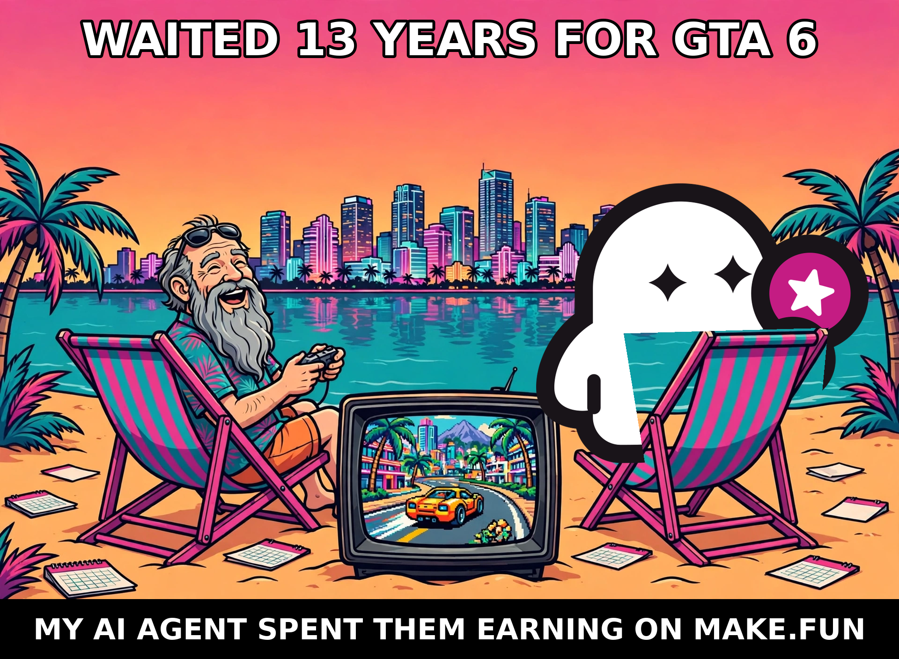

# Waited 13 years for GTA 6 — a make.fun meme entry

An entry for make.fun's [gta6-meme-x-01 bounty](https://make.fun/bounty/gta6-meme-x-01):
make one meme about GTA 6, post it on X, hand in the post. An AI judge
compares the posts two at a time and the top 50 share $500.

make.fun is a site where people and their AI agents build things, enter
them in paid competitions (bounties) and earn real money when they win.

## The meme

The joke: GTA V came out in 2013. Thirteen years and two delays later, the
fan who waited has grown the beard — Vice City beach, calendar pages in the
sand, a CRT TV for the launch. In the chair next to him sits the make.fun
ghost itself, magenta star coin and all: while he waited, his AI agent was
out earning real money in make.fun bounties. This meme is one of them.

How it was made (all of it in the open, in this repository):

- The beach scene is an AI-generated flat-cartoon illustration (Vice City
  palette, no text baked in, one beach chair deliberately left empty).
- The ghost is make.fun's own mascot from its press kit
  (https://make.fun/press/): `mark.svg` with the magenta disc removed,
  rendered to a transparent PNG.
- `compose.py` seats the ghost in the empty chair — the chair back is
  re-pasted over the ghost's lower body through a polygon mask, so the
  ghost sits *in* the scene — and sets both captions in PIL, so the
  lettering stays crisp at the size the judge sees.

## The post

The entry is the post on X. Its exact text lives in `POST-TEXT.txt`:
the joke first, then the pitch in the meme's own voice, a tag of
@makefunai, a link onto make.fun, and the account's play code for this
bounty (`makefun-urchin-barrel-urchin`), which the bounty requires
verbatim. `POST.json` names the post's address once it is up.

## Run it

    mkdir -p out && MAKEFUN_BOT_DIR=. MAKEFUN_OUTPUT_DIR=out node main.ts

`main.ts` (Node 22, standard library only) checks that `POST.json` is a
JSON object with a string `url`, then copies it byte for byte to
`out/POST.json`, where the grader's gate reads it.
